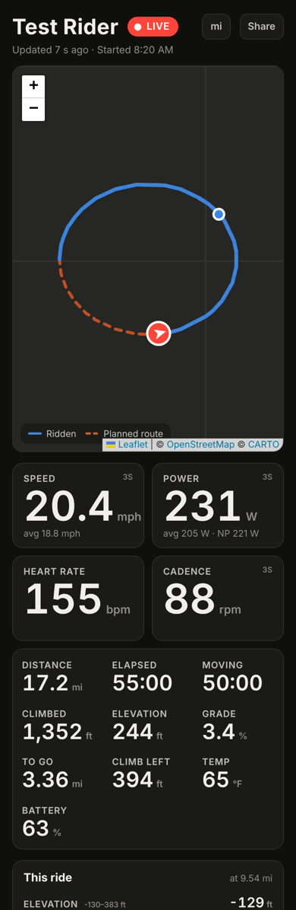

# Karoo Live

**Live ride tracking for Hammerhead Karoo, with the numbers.** Friends and family open one link and see your position on a map, plus 3-second speed, power, cadence and heart rate, with charts of the whole ride. Garmin LiveTrack-style, for the Karoo.

Your data goes to **your own free Firebase database**. There's no shared server, no account with anyone else, and nothing to host.

<p align="center">
  
</p>

| | Hammerhead live tracking | **Karoo Live** |
|---|---|---|
| Map and position | ✓ | ✓ |
| Planned route | ✓ | ✓ |
| Distance, time, climbing | Sent, but not shown by most viewers | ✓ |
| 3s speed, 3s power, 3s cadence, heart rate | ✗ | ✓ |
| Ride charts (elevation, speed, power, HR, cadence) | ✗ | ✓ |
| Karoo battery, grade, distance to go | ✗ | ✓ |
| Fills in gaps after a dead zone | ✗ | ✓ |

## How it works

```
Karoo (Karoo Live extension)  ──every 15 s──▶  your Firebase Realtime Database  ──live stream──▶  viewer page
   reads ride data via                            (free Spark plan,                               mybikeride.live              
   Hammerhead's official SDK                       only your Karoo can write)                     (static GitHub Pages)
```

- **`android/`** is a small Karoo extension built on Hammerhead's official [karoo-ext](https://github.com/hammerheadnav/karoo-ext) SDK. While a ride is recording, it sends a snapshot every 15 seconds (adjustable): position, heading, 3s speed, 3s power, 3s cadence, heart rate, distance, times, climbing, grade, temperature, battery, and route progress. If the signal drops, points are queued and sent when it comes back.
- **`web/`** is the viewer: one static page on GitHub Pages. It subscribes to your ride with the Firebase web SDK, so updates appear within a second of arriving, and draws the map with MapLibre (smooth vector maps, no API key).
- **`firebase/database.rules.json`** holds the database rules. Anyone with the link can read one ride; only your Karoo's login can write.

The viewer can also show [KarooTracker](https://k2tracker.drakey.co.uk) feeds (Hammerhead's own live tracking) with `?k2t=<id>`, either alone or as a fallback alongside Karoo Live.

## Get started

1. **[Follow the setup guide](docs/SETUP.md)** (about 20–30 minutes once): create a free Firebase project, install the APK, load your settings.
2. Use the **[setup page](https://mybikeride.live/setup.html)** to get your share link and a one-line install command.
3. Ride. Send people your link.

## Limitations

- **The Karoo needs internet while riding.** On a **Karoo 2**, that means a SIM card with data or your phone's Wi-Fi hotspot, the same as Hammerhead's own live tracking. A Karoo 2 can't send data through a Bluetooth-paired phone.
- **Karoo 3:** the extension sends through the Karoo system, which should also use the Companion App's connection. This hasn't been tested yet; reports are welcome.
- **Battery:** sending every 15 seconds uses the Karoo's radio a little more. Compare a ride with and without it; 30 seconds is a good setting for long days.
- **Unofficial:** this isn't a Hammerhead product. A Karoo software update could change how extensions behave.

## Privacy

- The share link contains a random 10-character id. Anyone with the link can see that ride; people without it can't find it.
- Location is only sent **while a ride is recording**. After the ride, the page shows the finished ride until your next one starts. Delete it any time in the Firebase console, or make a new link in the app.
- The Firebase login is stored on the Karoo. Use a password made just for this.

## Building

```bash
cd android
./gradlew assembleRelease        # APK: app/build/outputs/apk/release/app-release.apk
```

GitHub Actions builds every push. Pushing a `v*` tag publishes a release with `karoo-live.apk` and the Karoo `manifest.json`. The `web/` folder deploys to GitHub Pages automatically.

APKs are signed with a key committed in `android/app/` so every build installs over the previous one. It isn't a secret. To sign with your own key, set the `KAROO_LIVE_KEYSTORE*` environment variables (see `android/app/build.gradle.kts`).

## Credits

- [hammerheadnav/karoo-ext](https://github.com/hammerheadnav/karoo-ext) (Apache 2.0), vendored in `android/karoo-ext/`
- Inspired by KarooTracker by drakey
- Maps: [MapLibre GL JS](https://maplibre.org), vector tiles by [OpenFreeMap](https://openfreemap.org), data © OpenStreetMap contributors
- Live data: [Firebase](https://firebase.google.com) Realtime Database web SDK

Licensed under the Apache License 2.0.
