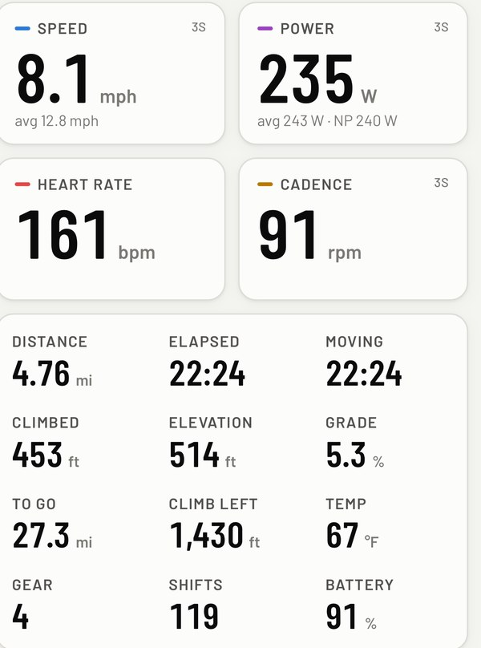
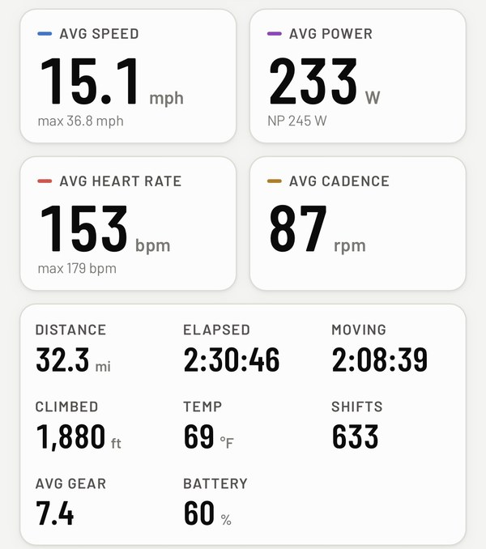
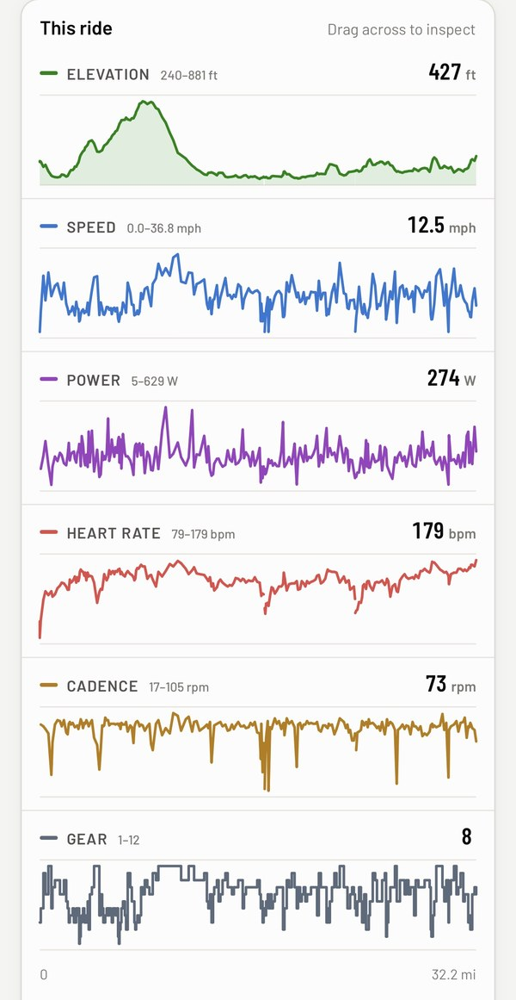
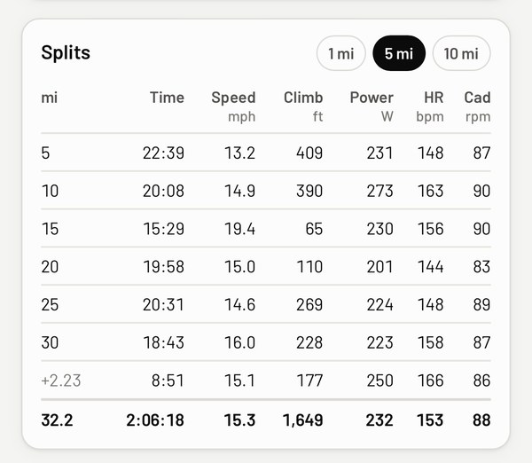
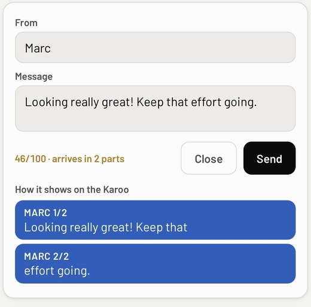

# Karoo Live

**Live ride tracking for Hammerhead Karoo, with the numbers.** Friends and family open one link and see your position on a map, plus 3-second speed, power, cadence and heart rate, with charts of the whole ride. Garmin LiveTrack-style, for the Karoo.

Your data goes to **your own free Firebase database**. There's no shared server, no account with anyone else, and nothing to host.

<table>
  <tr>
    <td align="center" valign="top"></td>
    <td align="center" valign="top"></td>
    <td align="center" valign="top"></td>
    <td align="center" valign="top"></td>
  </tr>
  <tr>
    <td align="center">During the ride</td>
    <td align="center">After the ride</td>
    <td align="center">Charts</td>
    <td align="center">Splits</td>
  </tr>
</table>

<sub>From a real 32-mile ride (Karoo 2, Pinion gearbox). The map sits above these on the page; it's left out here.</sub>

| | Hammerhead live tracking | **Karoo Live** |
|---|---|---|
| Map and position | ✓ | ✓ |
| Planned route | ✓ | ✓ |
| Distance, time, climbing | Sent, but not shown by most viewers | ✓ |
| 3s speed, 3s power, 3s cadence, heart rate | ✗ | ✓ |
| Ride charts (elevation, speed, power, HR, cadence) | ✗ | ✓ |
| Gear and shift count (Pinion gearbox or electronic derailleurs) | ✗ | ✓ |
| Karoo battery, grade, distance to go | ✗ | ✓ |
| Fills in gaps after a dead zone | ✗ | ✓ |
| Splits per mile or km | ✗ | ✓ |
| Viewers can send a message that pops up on the Karoo | ✗ | ✓ |

## Messages from viewers

While you're recording, anyone with your link can send a short note. The Karoo beeps and shows it as a banner; longer notes come in parts, and the page shows the sender exactly how it will look. Messages are rate-limited, and only your Karoo can read them. You can switch them off in the app. Setup: [Viewer messages](docs/SETUP.md#viewer-messages).

<p align="center">
  
</p>

## Group rides

Following a group? **[mybikeride.live/group.html](https://mybikeride.live/group.html)** puts several riders on one map: everyone's track and heading, the planned route, who's leading, the gaps between bunches, and who has lost signal or finished. The organizer pastes the riders' share links, and the group lives entirely in the link, with no account or server. Each rider's data stays in their own Firebase. Riders on Garmin, Wahoo and other trackers can be listed with a link to their own tracking page. See **[docs/GROUP.md](docs/GROUP.md)**.

## How it works

```
Karoo (Karoo Live extension)  ──every 15 s──▶  your Firebase Realtime Database  ──live stream──▶  viewer page
   reads ride data via                            (free Spark plan,                               mybikeride.live              
   Hammerhead's official SDK                       only your Karoo can write)                     (static GitHub Pages)
```

- **`android/`** is a small Karoo extension built on Hammerhead's official [karoo-ext](https://github.com/hammerheadnav/karoo-ext) SDK. While a ride is recording, it sends a snapshot every 15 seconds (adjustable): position, heading, 3s speed, 3s power, 3s cadence, heart rate, distance, times, climbing, grade, temperature, battery, and route progress. If the signal drops, points are queued and sent when it comes back.
- **`web/`** is the viewer: static pages on GitHub Pages (`index.html` for one rider, `group.html` for a group, sharing `common.js`). It subscribes to your ride with the Firebase web SDK, so updates appear within a second of arriving, and draws the map with MapLibre (smooth vector maps, no API key).
- **`firebase/database.rules.json`** holds the database rules. Anyone with the link can read one ride; only your Karoo's login can write it. Viewers can send short, rate-limited messages that only your Karoo can read (see [Viewer messages](docs/SETUP.md#viewer-messages)).

The viewer can optionally also read a [KarooTracker](https://k2tracker.drakey.co.uk) feed (a third-party copy of Hammerhead's own tracking) with `?k2t=<id>`. It's only a backup and isn't needed; that service has been unreliable.

## Get started

1. **[Follow the setup guide](docs/SETUP.md)** (about 20–30 minutes once): create a free Firebase project, install the APK, load your settings.
2. Use the **[setup page](https://mybikeride.live/setup.html)** to get your share link and a one-line install command.
3. Ride. Send people your link.

## Limitations

- **The Karoo needs internet while riding.** On a **Karoo 2**, that means a SIM card with data or your phone's Wi-Fi hotspot, the same as Hammerhead's own live tracking. A Karoo 2 can't send data through a Bluetooth-paired phone.
- **Karoo 3:** the extension sends through the Karoo system, which should also use the Companion App's connection. This hasn't been tested yet; reports are welcome.
- **Battery:** sending every 15 seconds uses the Karoo's radio a little more. Compare a ride with and without it; 30 seconds is a good setting for long days.
- **Unofficial:** this isn't a Hammerhead product. A Karoo software update could change how extensions behave.

## Privacy

- The share link contains a random 10-character id. Anyone with the link can see that ride; people without it can't find it.
- Location is only sent **while a ride is recording**. After the ride, the page shows the finished ride until your next one starts. Delete it any time in the Firebase console, or make a new link in the app.
- The Firebase login is stored on the Karoo. Use a password made just for this.

## Building

```bash
cd android
./gradlew assembleRelease        # APK: app/build/outputs/apk/release/app-release.apk
```

Viewer tests (headless Chromium, mocked Firebase) live in `tests/`; see [docs/GROUP.md](docs/GROUP.md#testing). GitHub Actions builds every push. Pushing a `v*` tag publishes a release with `karoo-live.apk` and the Karoo `manifest.json`. The `web/` folder deploys to GitHub Pages automatically.

APKs are signed with a key committed in `android/app/` so every build installs over the previous one. It isn't a secret. To sign with your own key, set the `KAROO_LIVE_KEYSTORE*` environment variables (see `android/app/build.gradle.kts`).

## Credits

- [hammerheadnav/karoo-ext](https://github.com/hammerheadnav/karoo-ext) (Apache 2.0), vendored in `android/karoo-ext/`
- Inspired by KarooTracker by drakey
- Maps: [MapLibre GL JS](https://maplibre.org), vector tiles by [OpenFreeMap](https://openfreemap.org), data © OpenStreetMap contributors
- Live data: [Firebase](https://firebase.google.com) Realtime Database web SDK

Licensed under the Apache License 2.0.
